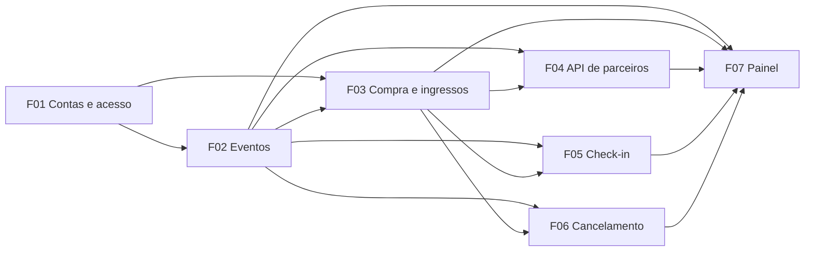

# PRD — Catraca MVP

Fonte: [`docs/brief.md`](brief.md). Este PRD divide o brief em features, declara o que cada uma provê e consome,
ordena a entrega em waves e define os critérios de aceite — inclusive os que atravessam features, que são onde a
primeira tentativa do produto falhou.

## 1. Visão

A Catraca vende ingressos para eventos pequenos. O organizador cria e opera os próprios eventos; o participante compra
pela vitrine; sistemas parceiros vendem pela API. O pagamento é assíncrono: a compra nasce pendente, já ocupa vaga e é
resolvida depois por um gateway (simulado no modo padrão).

**O que não pode falhar:** vender acima da lotação (R07), deixar entrar em evento cancelado (R10/R11), contar estorno
como receita (R12) e tratar compras da API de forma diferente das da vitrine.

## 2. Quem usa

| Persona | Acesso | O que faz |
|---|---|---|
| Visitante | sem login | vê a vitrine |
| Participante | conta própria (nome, e-mail, senha) | compra ingressos e vê os próprios ingressos |
| Organizador | conta da seed | cria, edita, publica e cancela os próprios eventos, faz check-in e vê o painel |
| Parceiro | chave no cabeçalho `X-Api-Key` | lista eventos, compra e consulta ingressos pela API |

## 3. Decisões que valem para todas as features

- **Endereços:** `/` (vitrine), `/eventos/:id` (página do evento, com a compra), `/cadastro`, `/entrar`, `/sair`,
  `/meus-ingressos`, `/organizador` (lista de eventos do organizador), `/organizador/eventos/novo`,
  `/organizador/eventos/:id` (página de gestão), `/api/partner/*` (API de parceiros).
- **Esquema compartilhado nasce a montante.** `events.status` já nasce na F02 com os três valores (`draft`,
  `published`, `cancelled`); `tickets` nasce na F03 com os cinco status e com `checked_in_at`. Assim as features da
  wave paralela (F04, F05, F06) não precisam de migração e não divergem sobre o modelo.
- **"À venda" tem uma única definição:** `status = 'published'` (R02). Vitrine, compra e API usam a mesma função.
- **Um único caminho de compra** (`purchaseTicket`), usado pela vitrine e pela API.
- **Status na interface em português** (pendente, confirmado, recusado, cancelado, estornado); na API, em inglês.

## 4. Features

### F01 — Contas e acesso

Cadastro, login e logout de participante; login de organizador (contas da seed); sessão e controle de acesso por papel.

- **Provê:** sessão por cookie; `getSessionUser`; guardas `requireParticipant` e `requireOrganizer`; páginas
  `/cadastro`, `/entrar`, `/sair`; entrada da área de organizador em `/organizador`; navegação que reflete quem está
  logado.
- **Consome:** nada de outra feature (a tabela `users` e a seed vêm do harness).

| ID | Critério de aceite | Regras |
|---|---|---|
| F01-AC1 | O visitante cria uma conta de participante com nome, e-mail e senha e já fica autenticado. E-mail repetido ou campo inválido é rejeitado com mensagem, sem criar conta | — |
| F01-AC2 | Participante e organizadores da seed entram com e-mail e senha; credencial errada é rejeitada com mensagem; sair encerra a sessão | — |
| F01-AC3 | Visitante que abre `/organizador` é levado para `/entrar`; participante logado recebe 403 sem conteúdo da área; organizador logado vê a área | R13 |
| F01-AC4 | Não há cadastro de organizador: toda conta criada em `/cadastro` é participante, mesmo que a requisição tente informar outro papel | R13 |
| F01-AC5 | A senha não é guardada em texto puro e o cookie de sessão é `HttpOnly` | — |

### F02 — Eventos

Ciclo de vida do evento na área do organizador (criar, editar, publicar) e a vitrine pública.

- **Provê:** tabela `events`; domínio `createEvent`, `updateEvent`, `publishEvent`, `getEventForOrganizer`,
  `listEventsByOrganizer`, `listSellableEvents`, `getSellableEvent`; lista em `/organizador`; página de gestão em
  `/organizador/eventos/:id`, com pontos de extensão (partials) para check-in, cancelamento e painel; vitrine em `/` e
  página do evento em `/eventos/:id`.
- **Consome:** F01 (`requireOrganizer`, usuário da sessão).

| ID | Critério de aceite | Regras |
|---|---|---|
| F02-AC1 | O organizador cria um evento com nome, data e hora de início, local, lotação (inteiro ≥ 1) e preço em reais (> 0). Valor inválido é rejeitado com mensagem e nada é criado | R01 |
| F02-AC2 | Data de início no passado é rejeitada ao criar e ao editar | R01 |
| F02-AC3 | O evento nasce rascunho e não aparece na vitrine; depois de publicado, aparece com nome, data, local e preço | R02 |
| F02-AC4 | Cada evento tem página de gestão com URL própria, onde o organizador edita e publica | R04 |
| F02-AC5 | A lista da área de organizador mostra só os eventos do próprio organizador; a página de gestão de evento alheio responde 404 sem nenhum dado do evento, e tentar editar ou publicar evento alheio não altera nada | R13 |
| F02-AC6 | O preço é informado e exibido em reais (`R$ 100,00`) e guardado em centavos | R01 |

### F03 — Compra e ingressos

Vagas, compra pela vitrine, gateway simulado assíncrono e "Meus ingressos".

- **Provê:** tabelas `tickets` e `gateway_charges`; `purchaseTicket` (único caminho de compra); `getSeatCounts` /
  vagas disponíveis; `getTicketById`, `findTicketByCode`; interface `PaymentGateway`, simulador e worker que aplica as
  respostas; compra em `/eventos/:id`; `/meus-ingressos`; piso de lotação na edição de evento.
- **Consome:** F01 (`requireParticipant`), F02 (`getSellableEvent`, `updateEvent`, vitrine e página do evento).

| ID | Critério de aceite | Regras |
|---|---|---|
| F03-AC1 | O participante logado compra um ingresso na vitrine com um cartão de 16 dígitos. O ingresso nasce pendente, com código único, e a resposta chega sem esperar o gateway | R06, R09 |
| F03-AC2 | Cartão final 0001: confirmado em até 5 s. Final 0002 ou qualquer outro final: recusado em até 5 s. Final 0003: confirmado entre 30 e 40 s. Final 0004: recusado entre 30 e 40 s | R08 |
| F03-AC3 | "Meus ingressos" mostra evento, status e código de cada ingresso do participante logado, e só os dele | R09 |
| F03-AC4 | Vagas ocupadas = pendentes + confirmados. Compra pendente ocupa vaga até a resposta do gateway; a recusa libera a vaga | R05, R06, R08 |
| F03-AC5 | Sem vaga disponível, a vitrine exibe `Ingressos esgotados` e nenhum ingresso é criado | R07 |
| F03-AC6 | 30 compras simultâneas em um evento novo de lotação 5 criam exatamente 5 ingressos e recusam 25, em todas as rodadas de um teste automatizado com pelo menos 10 rodadas | R07 |
| F03-AC7 | Número de cartão que não tem exatamente 16 dígitos é rejeitado antes de criar o ingresso | R06 |

### F04 — API de parceiros

As três rotas do contrato fixo do brief, autenticadas por chave.

- **Provê:** `GET /api/partner/events`, `POST /api/partner/events/{eventId}/purchases`,
  `GET /api/partner/tickets/{ticketId}`; autenticação por `X-Api-Key`.
- **Consome:** F02 (`listSellableEvents`), F03 (`purchaseTicket`, vagas disponíveis, `getTicketById`).

| ID | Critério de aceite | Regras |
|---|---|---|
| F04-AC1 | Sem o cabeçalho `X-Api-Key` ou com chave inválida, as três rotas respondem 401 com `{"error":"unauthorized"}` | — |
| F04-AC2 | `GET /api/partner/events` responde 200 com a lista dos eventos à venda, cada um com exatamente `id`, `name`, `startsAt` (ISO 8601 com fuso), `priceCents` e `availableSeats` | R02, R05 |
| F04-AC3 | A compra responde 202 com `ticketId`, `code` e `status` `pending`, sem esperar o gateway | R06 |
| F04-AC4 | Erros da compra, nesta ordem: corpo inválido (campo faltando, e-mail mal formado, cartão sem 16 dígitos) → 422 `invalid_request`; evento inexistente ou em rascunho → 404 `event_not_available`; sem vaga → 409 `sold_out` | R02, R07 |
| F04-AC5 | A consulta de ingresso responde 200 com `ticketId`, `code`, `eventId`, `status` e `checkedIn`; ingresso inexistente responde 404 com `{"error":"ticket_not_found"}` | — |
| F04-AC6 | Em duas rodadas, cada uma em um evento novo de lotação 5, 30 compras simultâneas pela API resultam em exatamente 5 respostas 202 e 25 respostas 409 | R07 |

### F05 — Check-in

Check-in por código na página de gestão do evento.

- **Provê:** `checkInTicket`; formulário e mensagem de resultado na página de gestão; preenchimento de
  `checked_in_at` (campo `checkedIn` da API).
- **Consome:** F02 (página de gestão, `getEventForOrganizer`), F03 (`findTicketByCode`, status do ingresso).

| ID | Critério de aceite | Regras |
|---|---|---|
| F05-AC1 | O check-in exibe a mensagem da primeira situação verdadeira, nesta ordem: código inexistente ou de outro evento → `Ingresso inválido para este evento`; evento cancelado → `Evento cancelado`; ingresso não confirmado → `Ingresso não confirmado`; já passou pelo check-in → `Ingresso já utilizado`; senão → `Entrada liberada` | R10 |
| F05-AC2 | `Entrada liberada` registra o check-in uma única vez: dois check-ins simultâneos do mesmo código resultam em exatamente uma `Entrada liberada` | R10 |
| F05-AC3 | O check-in fica na página de gestão do evento e só opera eventos do próprio organizador: em evento alheio responde 404 e não registra nada | R04, R13 |

### F06 — Cancelamento

Cancelamento irreversível de evento publicado, com estorno/cancelamento dos ingressos.

- **Provê:** `cancelEvent`; ação de cancelar na página de gestão; bloqueio de edição e republicação.
- **Consome:** F02 (página de gestão, `getEventForOrganizer`, edição/publicação), F03 (ingressos, trava do evento,
  aplicação das respostas do gateway).

| ID | Critério de aceite | Regras |
|---|---|---|
| F06-AC1 | O organizador cancela um evento publicado pela página de gestão. O cancelamento é irreversível: a página não oferece mais editar nem publicar, e requisições diretas de edição ou publicação são rejeitadas sem alterar o evento | R11 |
| F06-AC2 | Em até 10 s do cancelamento, ingressos confirmados ficam estornados e pendentes ficam cancelados; recusados continuam recusados | R11 |
| F06-AC3 | Resposta do gateway que chega depois do cancelamento (cartões finais 0003 e 0004) não muda o status de nenhum ingresso | R11 |
| F06-AC4 | Evento cancelado tem zero vagas disponíveis | R05 |
| F06-AC5 | Um organizador não consegue cancelar evento de outro; rascunho não é cancelável | R11, R13 |

### F07 — Painel

Os números do evento na página de gestão.

- **Provê:** `getEventDashboard`; painel na página de gestão com `Confirmados`, `Pendentes`, `Check-ins`,
  `Vagas disponíveis`, `Receita` e `Estornados`.
- **Consome:** F02 (página de gestão), F03 (ingressos, vagas, preço pago), F04 (vendas da API), F05 (check-ins),
  F06 (estornos, evento cancelado).

| ID | Critério de aceite | Regras |
|---|---|---|
| F07-AC1 | A página de gestão mostra o painel com os seis rótulos: Confirmados (confirmados, inclusive com check-in), Pendentes, Check-ins (confirmados que passaram pelo check-in), Vagas disponíveis (R05), Receita e Estornados | R12 |
| F07-AC2 | A Receita é a soma do valor pago pelos ingressos confirmados, com o preço vigente em cada compra, exibida em reais (`R$ 350,00`) | R03, R12 |
| F07-AC3 | O painel de um evento só é visível para o organizador dono | R13 |

## 5. Grafo de dependências

Uma seta `A --> B` significa "B consome o que A provê". São 14 dependências.

## 6. Waves

| Wave | Features | Depende de | Modo |
|---|---|---|---|
| W0 | Harness (não é feature) | — | direto na `main` |
| W1 | F01 | W0 | 1 branch, 1 PR |
| W2 | F02 | W1 | 1 branch, 1 PR |
| W3 | F03 | W2 | 1 branch, 1 PR |
| **W4** | **F04, F05, F06** | W3 | **paralelo: 3 worktrees, 3 branches, 3 PRs** |
| W5 | F07 | W4 | 1 branch, 1 PR |

**Integração da W4.** As três features são implementadas ao mesmo tempo. A ordem de merge é F04 → F05 → F06; antes de
ser avaliada, cada branch incorpora a `main` (já com as anteriores). Por isso os critérios de integração entre
features da própria wave (seção 7.2) ficam no contrato da que entra depois.

## 7. Critérios cross-feature

Cada critério comprova que o que uma feature provê chega e funciona na que consome. A coluna "Contrato" diz em qual
contrato o critério é coberto.

### 7.1 Um por dependência do grafo (no mínimo)

| ID | Dependência | Critério | Regras | Contrato |
|---|---|---|---|---|
| X-F01-F02-1 | F01 → F02 | O evento criado fica associado ao organizador da sessão. Visitante que abre `/organizador/eventos/novo` ou a página de gestão de um evento é levado para `/entrar`; participante logado recebe 403; em nenhum dos casos aparece dado do evento | R13 | F02 |
| X-F01-F03-1 | F01 → F03 | Uma conta criada em `/cadastro` compra um ingresso e o vê em "Meus ingressos"; outro participante não vê esse ingresso; visitante que tenta comprar é levado para `/entrar` e nenhum ingresso é criado | R06, R09 | F03 |
| X-F02-F03-1 | F02 → F03 | Evento em rascunho não aceita compra, nem por requisição direta; depois de publicado pelo organizador, aceita, e a vitrine mostra as vagas disponíveis | R02, R05 | F03 |
| X-F02-F03-2 | F02 → F03 | Na página de gestão, reduzir a lotação abaixo das vagas ocupadas é rejeitado com mensagem e a lotação não muda; reduzir até exatamente as vagas ocupadas ou aumentar é aceito | R03 | F03 |
| X-F02-F03-3 | F02 → F03 | Depois que o organizador muda o preço, os ingressos já comprados mantêm o valor pago e a compra seguinte usa o preço novo ("Meus ingressos" mostra o valor pago) | R03 | F03 |
| X-F02-F04-1 | F02 → F04 | Um rascunho criado na área de organizador não aparece em `GET /api/partner/events`; ao ser publicado, aparece com `priceCents` igual ao preço em centavos e `availableSeats` igual à lotação; editar o evento reflete na listagem | R02 | F04 |
| X-F03-F04-1 | F03 → F04 | Uma compra pela API ocupa vaga: `availableSeats` cai e, com o evento lotado pela API, a vitrine exibe `Ingressos esgotados`. O status consultado pela API acompanha o gateway (`pending` → `confirmed`/`declined`) e a recusa devolve a vaga. Um ingresso comprado na vitrine é consultável pela API | R05, R06, R07, R08 | F04 |
| X-F02-F05-1 | F02 → F05 | O formulário de check-in aparece na página de gestão do evento; um código de ingresso de outro evento (do mesmo organizador ou de outro) resulta em `Ingresso inválido para este evento` | R04, R10 | F05 |
| X-F03-F05-1 | F03 → F05 | Um ingresso comprado na vitrine resulta em `Ingresso não confirmado` enquanto pendente e em `Entrada liberada` depois que o gateway confirma; um ingresso recusado resulta em `Ingresso não confirmado` | R08, R10 | F05 |
| X-F02-F06-1 | F02 → F06 | O evento cancelado some da vitrine e a página do evento não oferece compra; a página de gestão passa a mostrar o evento como cancelado, sem formulário de edição e sem publicar | R02, R11 | F06 |
| X-F03-F06-1 | F03 → F06 | Ingressos comprados na vitrine aparecem em "Meus ingressos" como estornado (era confirmado) ou cancelado (era pendente) depois do cancelamento, e continuam assim depois da janela de resposta do gateway; uma tentativa de compra por requisição direta é recusada | R11 | F06 |
| X-F02-F07-1 | F02 → F07 | O painel aparece na página de gestão de cada evento; em um evento sem vendas mostra zeros e `Vagas disponíveis` igual à lotação, e acompanha a edição da lotação | R04, R12 | F07 |
| X-F03-F07-1 | F03 → F07 | Compra pendente conta em Pendentes e reduz as Vagas disponíveis; confirmada conta em Confirmados e na Receita; recusada não conta e devolve a vaga. Com mudança de preço entre compras, a Receita soma o preço de cada compra | R03, R05, R12 | F07 |
| X-F04-F07-1 | F04 → F07 | Compras pela API contam no painel como as da vitrine. Depois de 30 compras simultâneas pela API em um evento de lotação 5, o painel mostra Confirmados 5 e Vagas disponíveis 0 em até 10 s | R07, R12 | F07 |
| X-F05-F07-1 | F05 → F07 | Um check-in com `Entrada liberada` aumenta Check-ins em 1 e não altera Confirmados; tentativas que não liberam entrada não alteram o painel | R10, R12 | F07 |
| X-F06-F07-1 | F06 → F07 | Em um evento cancelado que tinha um ingresso confirmado (com ou sem check-in) e um pendente, o painel mostra Confirmados 0, Pendentes 0, Check-ins 0, Vagas disponíveis 0, Receita `R$ 0,00` e Estornados 1 | R05, R11, R12 | F07 |

### 7.2 Integração dentro da Wave 4 (sem dependência no grafo)

F04, F05 e F06 não dependem uma da outra, mas se encontram no produto. Foi nesses encontros que a primeira tentativa
quebrou.

| ID | Encontro | Critério | Regras | Contrato |
|---|---|---|---|---|
| X-F04-F05-1 | API × check-in | Um ingresso comprado pela API e confirmado passa no check-in com `Entrada liberada`, e a consulta pela API passa a mostrar `checkedIn` `true` | R10 | F05 |
| X-F04-F06-1 | API × cancelamento | O evento cancelado sai de `GET /api/partner/events`; uma compra pela API responde 404 com `event_not_available`; ingressos comprados pela API ficam `refunded` (era confirmado) e `cancelled` (era pendente) em até 10 s e continuam assim 45 s depois da compra | R02, R11 | F06 |
| X-F05-F06-1 | Check-in × cancelamento | Em evento cancelado, o check-in de um ingresso do evento resulta em `Evento cancelado` e não registra entrada; um código inexistente continua resultando em `Ingresso inválido para este evento` | R10, R11 | F06 |

## 8. Rastreabilidade das regras

| Regra | Critérios |
|---|---|
| R01 | F02-AC1, F02-AC2, F02-AC6 |
| R02 | F02-AC3, F04-AC2, F04-AC4, X-F02-F03-1, X-F02-F04-1, X-F02-F06-1, X-F04-F06-1 |
| R03 | F07-AC2, X-F02-F03-2, X-F02-F03-3, X-F03-F07-1 |
| R04 | F02-AC4, F05-AC3, X-F02-F05-1, X-F02-F07-1 |
| R05 | F03-AC4, F04-AC2, F06-AC4, X-F02-F03-1, X-F03-F04-1, X-F03-F07-1, X-F06-F07-1 |
| R06 | F03-AC1, F03-AC4, F03-AC7, F04-AC3, X-F01-F03-1, X-F03-F04-1 |
| R07 | F03-AC5, F03-AC6, F04-AC4, F04-AC6, X-F03-F04-1, X-F04-F07-1 |
| R08 | F03-AC2, F03-AC4, X-F03-F04-1, X-F03-F05-1 |
| R09 | F03-AC1, F03-AC3, X-F01-F03-1 |
| R10 | F05-AC1, F05-AC2, X-F02-F05-1, X-F03-F05-1, X-F04-F05-1, X-F05-F06-1, X-F05-F07-1 |
| R11 | F06-AC1, F06-AC2, F06-AC3, F06-AC5, X-F02-F06-1, X-F03-F06-1, X-F04-F06-1, X-F05-F06-1, X-F06-F07-1 |
| R12 | F07-AC1, F07-AC2, X-F02-F07-1, X-F03-F07-1, X-F04-F07-1, X-F05-F07-1, X-F06-F07-1 |
| R13 | F01-AC3, F01-AC4, F02-AC5, F05-AC3, F06-AC5, F07-AC3, X-F01-F02-1 |

## 9. Fora de escopo

- Deploy e qualquer ambiente além do local.
- Gateway de pagamento real, e-mail e notificações.
- App mobile e qualidade visual.
- Cadastro, edição ou recuperação de conta de organizador pelo produto; recuperação de senha de participante.
- Mais de um ingresso por compra, mapa de assentos, cancelamento ou transferência de ingresso pelo participante.
- Atualização em tempo real: recarregar a página para ver o status novo basta.
- Tratamento de fuso horário além de um fuso fixo do produto (America/Sao_Paulo).
- Excluir evento, despublicar evento e desfazer check-in.
- Mais de uma chave de parceiro, limites de uso e paginação na API.
- Vínculo de compras da API a contas de participante.
